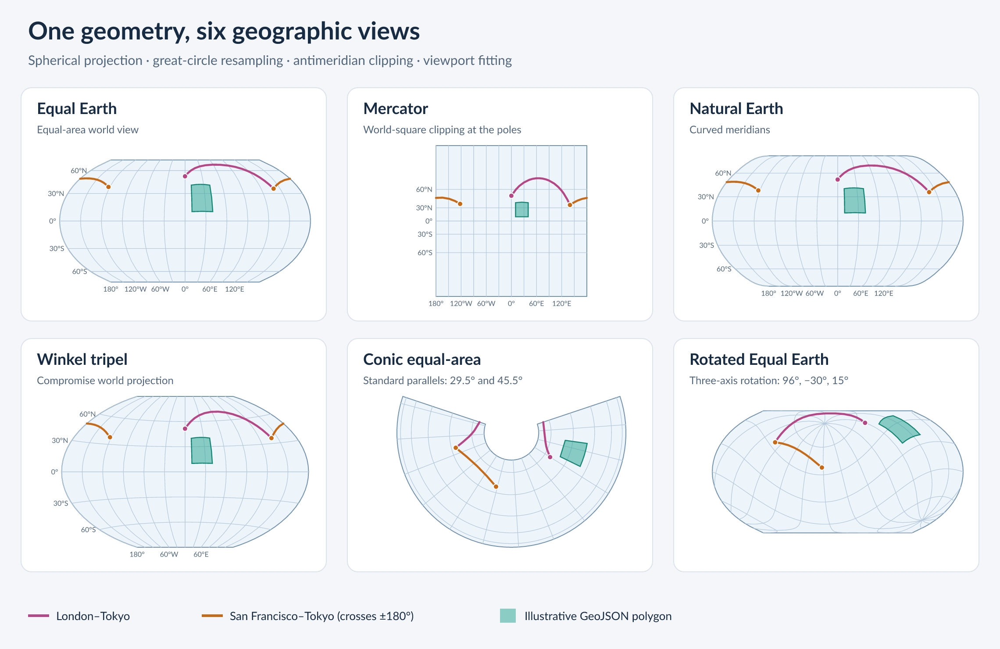

# avenger-guides-geo

Map guides for Avenger scene graphs. `make_sphere_marks` fills a projection's
outline and strokes it. `Graticule` draws the graticule's meridians and
parallels and labels them where they meet the map's edge, as the axes of
`avenger-guides` label their ticks.

A `Graticule` is prepared once from an unfitted `Projection`, a `FitSummary` of
what the map shows, a `GraticuleConfig`, and a text engine. It formats and
measures its labels once. Each method then takes the map's size, or the length
of one of its sides, and fits the projection to it, so the labels, the lines,
and the data agree at every size:

- `aspect()` is the map's width over its height, where the fitted map fills its
  rectangle.
- `projector(size)` projects the map's data.
- `lines(size)` draws the lines, behind the data.
- `marks(size)` draws the labels of every side, for a map without a layout.
- `extent(side, length)`, `part(side, length)`, and `origin(side, slot)` size,
  draw, and place one side's labels in a layout slab, as `Axis` does for its
  parts.

```rust
use avenger_geo::projections::EqualEarth;
use avenger_geo::Projection;
use avenger_guides_geo::{make_sphere_marks, Graticule, GraticuleConfig, SphereStyle};
use avenger_scenegraph::marks::group::SceneGroup;
use avenger_typst_label::LabelEngine;

fn world_map(engine: &LabelEngine) -> Result<SceneGroup, Box<dyn std::error::Error>> {
    let projection = Projection::new(EqualEarth);
    let summary = projection.summarize_sphere()?;
    let graticule = Graticule::new(&projection, &summary, &GraticuleConfig::default(), engine)?;
    let size = [600.0, 600.0 / graticule.aspect()];
    let projector = graticule.projector(size);
    Ok(SceneGroup {
        origin: [40.0, 10.0],
        marks: vec![
            make_sphere_marks(&projector, &SphereStyle::default()).into(),
            graticule.lines(size).into(),
            graticule.marks(size).into(),
        ],
        ..Default::default()
    })
}
```

## Frames and labels

`GraticuleConfig::frame` sets the map's edge. `MapFrame::Outline`, the default,
fits the projection's outline in the map's rectangle, as for a world map. Each
line is labeled at its end nearest the side, on the outline. Such a label can
sit inside the map's rectangle, and the side's thickness counts only how far
its labels reach past the edge. `MapFrame::Rectangle` fills the rectangle with
the map and clips the map to it, as for a regional map. Each line is labeled
where it crosses the side's edge. The graticule sets the clip extent, so the
projection takes none of its own.

`GraticuleConfig::graticule` sets the lines' steps and extents, and
`label_sides` the sides that label them: meridians on the top and bottom, and
parallels on the left and right. While a side's labels overlap, every other one
is left out, so the rest stay evenly spaced. A label that overlaps one on an
earlier side is left out too.

Labels are the lines' degrees, followed by `°` and N, S, E, or W. The text
engine's number provider formats the degrees with `label_format`, a pattern in
its syntax, so the engine needs one, which `LabelEngine::with_number_formatting`
sets. An empty pattern takes the provider's default.

## Maps in a layout

In an `avenger-layout` layout, a map is a leaf that keeps the map's aspect with
`Leaf::aspect(graticule.aspect())`, with a slab on each labeled side. A measure
answers each slab with its side's extent, which holds only at the asked length:

```rust
let extent = graticule.extent(side, length);
Measurement::over(extent.thickness, extent.holds).with_overhang(extent.overhang)
```

The map draws through `projector` and `lines` at its leaf's content size, and
each slab draws `part(side, length)` at `origin(side, slot)`.

## Example

```sh
cargo run --release -p avenger-guides-geo --example projection_gallery
```

The example lays out six maps with `avenger-layout`: five world maps and a
regional conic clipped to its frame. It draws the same routes and polygon on
each with `avenger-svg`, and rasterizes the SVG to PNG. It writes both files to
`target/geo-gallery`, or to the directory given as its first argument. It uses
the bundled Lato fonts without the system's, so the output is the same on every
machine.


