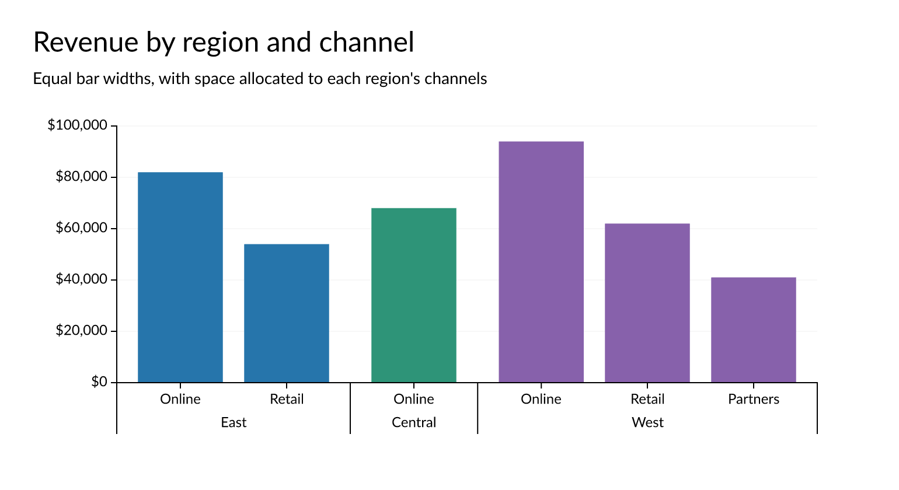

# avenger-guides

Visualization guide generation for Avenger (axes, legends, colorbars).

## Purpose

This crate generates the visual guides that help users interpret data visualizations. It creates scene graph elements for axes, legends, and colorbars using scale information to produce properly positioned and formatted guide components.

## Integration

- **Input**: Uses `avenger-scales::ConfiguredScale` for scale information and data mappings
- **Output**: Generates `avenger-scenegraph` mark hierarchies for rendering
- **Labels**: Axes and colorbars format ticks with the text engine's number and datetime providers, which `LabelEngine::with_number_formatting` and `with_datetime_formatting` set. `tick_format` is one pattern for numeric and temporal ticks, in the provider's syntax, such as `",.0f"` or `"%b %d"`. Numbers use the number provider. Dates and timestamps use the datetime provider: timestamps without a timezone as naive datetimes, and timestamps with one as instants, which the provider must show in the scale's timezone. An empty pattern takes the provider's default, which for dates and times is its calendar patterns. Ticks fail to format when the engine lacks their provider. Numeric ticks are formatted together, with the scale's `tick_spacing`: `TickSpacing::Varying` for log, threshold, and quantile scales, and `TickSpacing::Uniform` for other scales. Axes label the ticks that the scale's `label_ticks` chooses, so log axes label only the minor ticks that fit the requested density. Band and point axes format numeric and temporal categories each on its own, and show other categories, such as strings, as text.
- **Formatted values**: `axis::format_values` formats values through a text engine as axes label them, for callers that compare guides by their labels.
- **Label markup**: `tick_label` is Typst markup for each label, where `#tick` is the tick as `tick_format` formats it, as in `#tick m/s` or `*#tick*`. Numeric ticks with exponent typesetting are Typst math, with or without it.
- **Styling**: `AxisConfig::style` holds colors, fonts, tick count and placement, and title markup. Symbol, line, and colorbar legends share a `LegendStyle` for their background, title, and labels, and `ColorbarStyle` adds the colorbar's thickness, length, and axis gap. Each style's `Default` is the default look.
- **Legends**: `make_symbol_legend` and `make_line_legend` return a `GuideLegendOutput`: the rendered group and the scene paths of its entries. `make_colorbar_legend` returns a `ColorbarOutput`: the rendered group and the scene path and bounds of its gradient. Callers attach interactions through these paths and place a legend through its group's origin.
- **Label angles**: Rotated labels align to the end nearest their tick, so that they extend away from the axis, as Vega-Lite aligns them. `label_align` and `label_baseline` set the alignment instead.
- **Nested band axes**: `make_nested_band_axis_marks` draws a nested band scale's leaf level as a band axis does and stacks a label row for each outer level outward from it, with separators between that level's bands. Per-level settings hide a level, retitle it, or set its label angle or tick format. Without an explicit title, the axis title joins the visible levels' titles with " / ". A level's numeric and temporal keys are formatted with its tick format, or else the axis's, and explicit labels show as written.

  
