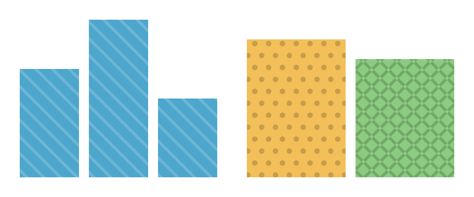

# avenger-scenegraph

Scene graph data structure for 2D visualization rendering.

## Purpose

This crate defines the core intermediate representation used by the Avenger rendering system. It provides a hierarchical scene graph that bridges the gap between high-level visualization specifications (like Vega) and low-level rendering backends.

## Core Architecture

### SceneGraph
The root container holding:
- A collection of top-level marks
- Canvas dimensions (width, height)
- Origin coordinates for positioning

### SceneMark Types
Represents different visual primitives:
- **Geometric**: Arc, Area, Path, Line, Trail, Rect, Rule, Symbol
- **Content**: Text, Image  
- **Structural**: Group (hierarchical containers)

### SceneGroup
Hierarchical grouping with support for:
- Coordinate transformations and origin offsets
- Clipping regions (rectangular or path-based)
- Nested mark hierarchies
- Gradient definitions
- Fill and stroke styling
- Pattern reference frames, where frame-anchored pattern fills start

### Pattern Fills
Rect, path, symbol, arc, and area marks take a `fill_pattern` that draws over their fill: up to
eight layers of stripes, which can be dashed, and of built-in symbol shapes repeated on a lattice.
Each layer adds to the pattern's coverage, subtracts from it, or flips it with XOR, and the coverage
is painted once, in a solid ink or in black or white to contrast with the fill. A pattern's `anchor` sets where its
stripes and lattices start: the nearest enclosing group's `pattern_reference_frame`, or the scene
when no group sets one, each mark item's bounds, or the scene. Marks that share a frame share their
pattern's phase.

`cargo run --release -p avenger-wgpu --example patterns` renders this scene.

## Data Representation

Mark properties use `ScalarOrArray<T>` for efficient storage:
- Single values for uniform properties across instances
- Arrays for per-instance variation
- Optional indices for sparse data access

## Integration

- **Input**: `avenger-vega` converts Vega scenegraphs to this representation
- **Output**: `avenger-wgpu` renders scene graphs using GPU acceleration
- **Dependencies**: Uses `avenger-typst-label` for labels and `avenger-image` for image data
